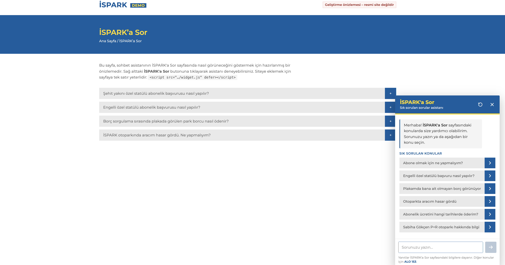

# İSPARK'a Sor Asistanı

> **Bağımsız prototip.** Bu proje kişisel bir çalışmadır; İSPARK A.Ş. ile resmi bir bağlantısı yoktur.
> Bilgiler, herkese açık [İSPARK'a Sor](https://ispark.istanbul/isparka-sor/) sayfasından alınmıştır.



[İSPARK'a Sor](https://ispark.istanbul/isparka-sor/) sayfasındaki 28 soru-cevaba dayanan sohbet asistanı.
Yerel bir dil modeli (Ollama) ile çalışır; API anahtarı veya internet gerekmez.

Hazır cevap vermez. Her soruda ilgili SSS maddeleri **sistem mesajı** olarak modele verilir; model
soruyu anlar, bu bilgilerden çıkarım yapar ve kullanıcının durumuna göre yanıtı kendisi yazar.
Bilgilerin dışına çıkmaz; kapsam dışı sorular ALO 153'e yönlendirilir.

## Çalıştırma

```bash
ollama pull qwen3:4b-instruct   # ~2,5 GB, düşünme modu olmayan sohbet modeli
npm start                       # http://localhost:3000
```

Node.js 22.9+ gerekir; ek npm paketi yoktur. Demo: `http://localhost:3000/` · Durum: `/api/health`

> Not: `qwen3:4b` (etiketsiz) "düşünen" sürümdür; her cevaptan önce uzun bir İngilizce akıl yürütme
> yazdığı için sohbette çok yavaştır. `qwen3:4b-instruct` kullanın.

## Nasıl çalışır

```
soru ─► ilgili 3 SSS maddesini bul ─► sistem mesajı = kurallar + bu maddeler ─► Ollama (akış) ─► widget
```

- **Bilgi seçimi** (`retrieval.js`): Varsayılan olarak modelsiz kelime araması (BM25, Türkçe ek
  kırpma, her maddede `anahtar` kelimeler). Bellekte ek model tutmaz.
- **Sistem mesajı** (`prompt.js`): Sabit kurallar başta durur; Ollama bu kısmı önbellekte tutar.
- **Kuyruk:** Model aynı anda tek yanıt üretir; bekleyen kullanıcı "Sıradasınız" mesajı görür.
- **Adres kontrolü:** Model SSS'de olmayan bir internet adresi yazarsa İSPARK'a Sor sayfasıyla değiştirilir.
- Takip soruları ("peki iade olur mu?") için önceki soru da aramaya katılır; modele son 6 mesaj gider.

## Ayarlar (`.env` veya ortam değişkeni, bkz. `.env.example`)

| Değişken | Varsayılan | Açıklama |
|---|---|---|
| `OLLAMA_MODEL` | `qwen3:4b-instruct` | Sohbet modeli |
| `FAQ_MODE` | `rag` | `rag`: ilgili maddeler · `full`: tüm SSS sistem mesajında (16 GB+ RAM) |
| `FAQ_TOP_K` | `3` | `rag` modunda sistem mesajına giren madde sayısı |
| `RETRIEVAL` | `lexical` | `embedding`: bge-m3 ile anlamsal arama (+1,2 GB bellek) |
| `OLLAMA_NUM_CTX` | `3072` / `8192` | Bağlam uzunluğu (rag / full) |
| `OLLAMA_KEEP_ALIVE` | `30m` | Model boştayken bellekte kalma süresi |
| `OLLAMA_URL` | `http://127.0.0.1:11434` | Ollama adresi |
| `PORT` | `3000` | Sunucu portu |
| `ALLOWED_ORIGINS` | – | Widget'ın gömüleceği alan adları (virgülle) |
| `TRUST_PROXY` | – | `1`: ters vekil arkasında `X-Forwarded-For` ile IP al |

## Donanım

Ölçümler (M1, 8 GB RAM, `rag` + `lexical`): ilk kelime 6–17 sn, tam cevap 20–45 sn, ~3,2 GB bellek.
Bu makinede darboğaz bellek: Docker gibi uygulamalar açıkken sistem swap'a düşer ve her şey yavaşlar.

- 8 GB: varsayılan ayarlar. Docker ve ağır uygulamaları kapatmak hızı belirgin artırır.
- 16 GB+: `RETRIEVAL=embedding` veya `FAQ_MODE=full` (tüm SSS önbellekte; sonraki sorular çok hızlı).
- Sitede gerçek kullanıcılara açılacaksa GPU'lu ya da 16 GB+ bir sunucu önerilir.

## Siteye ekleme

```html
<script src="https://ASISTAN-SUNUCUSU/widget.js" defer></script>
```

Farklı alan adından sunuluyorsa: `ALLOWED_ORIGINS=https://ispark.istanbul npm start`.
Sayfadaki başka bir butondan açmak için: `window.isparkAsistan.open()`

## Dosyalar

- `faq.js`: Sayfadaki soru-cevaplar (+ arama için `anahtar` kelimeler). **Sayfa güncellenirse güncelleyin.**
- `prompt.js`: Asistanın kuralları ve sistem mesajı.
- `retrieval.js`: İlgili maddeyi bulma (BM25 / bge-m3).
- `ollama.js`: Ollama istemcisi (akış, ısınma, model kontrolü).
- `server.js`: `/api/chat` (SSE), doğrulama, kuyruk, hız sınırı (IP başına 15/dk).
- `public/widget.js`: Gömülebilir sohbet penceresi (Shadow DOM).
